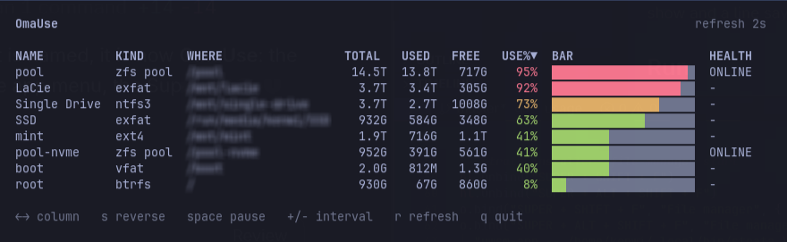

# OmaUse

A terminal view of mounted filesystems and ZFS pools. Each row shows the name, kind, mount path, total, used, free, percentage, a fullness bar, and pool health.

The bar and percentage are green under 70%, yellow from 70% to 89%, and red at 90% and above. The list refreshes every 2 seconds, and every column can be sorted.



## Install

```sh
./install.sh
./install.sh --uninstall   # or -u
```

This builds `omause` and installs `omause-launch` into `~/.local/bin`, and adds an **OmaUse** launcher in `~/.local/share/applications`. `omause-launch` measures the table, opens foot at that character size, and Hyprland floats and centers the OmaUse window.

The installer asks whether to:

- bind **SUPER + SHIFT + U** in `~/.config/hypr/bindings.lua`
- install a crontab entry that runs `omause -q` every minute
- open the quiet-mode config in your editor (`VISUAL` / `EDITOR`)

Uninstall removes the hotkey, binaries, desktop entry, crontab, and quiet-mode state, then asks whether to delete the config too.

`go` and `foot` are required to install. ZFS pools are included when `zpool` is available; otherwise only filesystems are shown.

## Run

```sh
omause
```

Or launch **OmaUse** from the app menu, or use the hotkey if you installed it.

## Quiet mode

```sh
omause -q
omause -c       # reset fired alerts
omause -c -q    # reset, then check and notify
```


Collects drive and pool usage once, applies alerts from `~/.config/omause/config.json`, then exits (no TUI). Install copies an example config only when that file is missing; an existing config is never overwritten.

Each threshold notifies once via `omarchy-notification-send`. An optional `script` runs when that level is crossed. Fired levels are stored in `~/.local/state/omause/thresholds.json` and reset when usage falls below them, so the next crossing alerts again.

```json
{
  "enabled": true,
  "flux": false,
  "thresholds": [
    { "percent": 80 },
    { "percent": 90 },
    {
      "percent": 100,
      "drive": "/pool",
      "script": "/home/you/.config/omause/cleanup-pool.sh"
    }
  ]
}
```

Set `"enabled": false` to keep thresholds defined but skip all alerts. Set `"flux": true` to also send each alert to your phone with `flux notify`. An optional `"drive"` (mount path or volume name) limits that threshold to one volume; omit it to apply to every drive.

Scripts receive `OMAUSE_NAME`, `OMAUSE_WHERE`, `OMAUSE_USE_PCT`, `OMAUSE_THRESHOLD`, and size fields in the environment.

Cron needs your session bus so desktop and Flux notifications still work. Example every minute (`crontab -e`):

```cron
* * * * * XDG_RUNTIME_DIR=/run/user/1000 DBUS_SESSION_BUS_ADDRESS=unix:path=/run/user/1000/bus PATH=$HOME/.local/bin:/usr/lib/flux/bin:/usr/bin:/bin flock -n /tmp/omause-quiet.lock $HOME/.local/bin/omause -q
```

Replace `1000` with your user id (`id -u`) if it differs.

## Keys

| Key | Action |
| --- | --- |
| Left / Right | Move the sort column |
| `s` | Reverse sort direction |
| Space | Pause or resume the timer |
| `+` / `-` | Change the refresh interval (1-60 seconds) |
| `r` | Refresh now |
| `q` | Quit |

Use% starts descending, so the fullest volume is first. Other columns start ascending. Sizes that cannot be read sort last.

## License

MIT. See [LICENSE](LICENSE).
